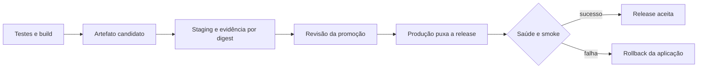

# MyFoodLink · engenharia de um SaaS multi-tenant para restaurantes

[](https://github.com/joaoluan/myfoodlink-engineering/actions/workflows/ci.yml)


O **MyFoodLink (MFL)** é um SaaS para restaurantes que integra relacionamento com o cliente, vendas online, gestão da plataforma e operação local da loja. O desafio de engenharia é manter essas partes coerentes diante de mensagens repetidas, falhas de rede, concorrência, diferentes permissões e dados de vários restaurantes.

Este repositório reúne uma **visão técnica do produto e exemplos executáveis sanitizados**. O código completo do SaaS permanece privado. Os exemplos permitem examinar decisões e reproduzir comportamentos sem acessar clientes, serviços ou ambientes reais.

## Por onde começar

| Interesse | Leitura |
|---|---|
| Entender o produto e suas fronteiras | [Mapa do SaaS](docs/produto.md) |
| Avaliar arquitetura e integração entre sistemas | [Arquitetura](docs/arquitetura.md) |
| Discutir escolhas, custos e alternativas | [Decisões de engenharia](docs/decisoes.md) |
| Preparar a apresentação do projeto final | [Roteiro técnico](docs/apresentacao.md) |
| Verificar o que este material comprova | [Evidências e limites](docs/evidencias.md) |
| Executar código e avaliar regressões | Casos abaixo e `npm test` |

A documentação foi reconciliada em **08/11/2026** com referências técnicas locais do projeto. Essa revisão é documental; não representa inspeção do ambiente em execução. Funcionalidades implementadas, homologação e uso real têm evidências diferentes, explicitadas no [mapa do SaaS](docs/produto.md).

## Demonstração: venda offline e sincronização sem efeito duplicado

O [caso 11](docs/casos/11-venda-offline-e-sincronizacao.md) acrescenta um fluxo completo com **SQLite real**, sem serviços externos: confirmar venda offline, persistir evento, perder a resposta após o commit remoto e reenviar sem duplicar a projeção.

```sh
# Node.js >= 22.13 para este recorte (usa node:sqlite)
npm run demo:sync
npm run test:sync
```

- [Persistência e ingestão](src/sync/store.js): transações, constraints, isolamento por tenant e detecção de evento alterado.
- [Worker](src/sync/worker.js): confirmação explícita por ID, backoff com jitter e coordenação de chamadas simultâneas.
- [Testes de integração](test/integration/sync.test.js): arquivos reais, reabertura do banco e falhas controladas.

É uma implementação demonstrativa dos padrões do Gestor. O destino usa SQLite para execução independente; não é uma cópia do serviço privado de sincronização.

## Problemas reais e como foram resolvidos

| # | Problema | Área | Solução |
|---|---|---|---|
| 01 | [Cliente recebendo a mesma resposta duas vezes](docs/casos/01-mensagens-duplicadas.md) | Webhooks | Deduplicação após admissão bem-sucedida, concorrência e reenvio após falha |
| 02 | ["Cancelar" virando descadastro de marketing](docs/casos/02-cancelar-virando-descadastro.md) | LGPD, produto | Opt-out por contexto, preservando o descadastro na dúvida |
| 03 | [Webhook de pagamento de outro restaurante derrubando o endpoint](docs/casos/03-webhook-de-pagamento-de-outro-restaurante.md) | Pagamentos, multi-tenant | Ignorar evento de conta desconhecida; um gateway por restaurante |
| 04 | [O cardápio que travava para sempre](docs/casos/04-deadlock-de-pool-no-postgres.md) | PostgreSQL, concorrência | Conexão da transação passada adiante e prazos no pool |
| 05 | [Redis que desistia de reconectar depois de um deploy](docs/casos/05-redis-que-desistia.md) | Resiliência | Limite de tentativas só no boot |
| 06 | [O mesmo cliente duplicado no CRM](docs/casos/06-um-telefone-um-contato.md) | Dados | Telefone brasileiro canônico e chave única por contato |
| 07 | [Backup diário perdido por disputa de lock](docs/casos/07-backup-perdido-por-disputa-de-lock.md) | Operação, incidente | Backup espera o lock; coleta de métricas pode pular |
| 08 | [Deploy que se protege sozinho](docs/casos/08-deploy-que-se-protege.md) | CI/CD | Deploy puxado com portões e rollback automático |
| 09 | [Provisionar um restaurante sem deixar nada pela metade](docs/casos/09-restaurante-pela-metade.md) | Multi-tenant | Preflight, confirmação, rollback só do que foi criado |
| 10 | [O risco de um subdomínio servir o restaurante errado](docs/casos/10-subdominio-servindo-outro-cliente.md) | Proxy, isolamento | Reload do proxy e validação do tenant no pós-deploy |

## Revisão do demonstrativo

O [caso 01](docs/casos/01-mensagens-duplicadas.md) foi revisado neste repositório demonstrativo: a versão anterior marcava o ID antes da gravação e respondia 200 em caso de erro, podendo descartar uma mensagem não gravada. A correção pública responde 503 na falha, libera o ID para uma nova tentativa e faz entregas simultâneas aguardarem a mesma admissão. Os testes agora cobrem falha seguida de recuperação. Essa revisão não modifica nem atesta o comportamento do código privado em produção; os contratos de persistência e os limites do cache em memória estão documentados no caso.

## Do código à operação



Esse fluxo corresponde aos serviços publicados por imagem. Os frontends público e do restaurante têm publicação própria na Vercel. Rollback da aplicação não equivale a restaurar dados. Detalhes em [CI/CD](docs/ci-cd.md).

## Stack do produto

**Backend:** Node.js, Express, PostgreSQL, Redis, Evolution API (WhatsApp), Stripe e Mercado Pago
**Operação local:** TypeScript, SQLite, outbox/inbox, PDV, garçom e KDS
**Frontend:** Next.js, React, TypeScript, Tailwind, monorepo com Turborepo
**Operação:** Docker, GitHub Actions, GHCR, Nginx, Cloudflare, Tailscale, WAL-G, Prometheus, Grafana, Loki, cofre de segredos
**Qualidade:** Node Test Runner, Vitest, Playwright, testes de regressão dos scripts de operação

## Rodando este repositório

Requer Node.js 20 ou superior, `bash` e `flock` (Linux). Sem dependências externas.

```sh
npm test               # testes de todos os casos
npm run lint:shell     # ShellCheck nos scripts de operação (requer shellcheck)
```

```
src/
  webhook/        casos 01 e 02 (admissão do webhook, deduplicação)
  consent/        caso 02 (descadastro por contexto)
  payments/       caso 03 (webhook Connect multi-tenant)
  db/             caso 04 (redes de segurança do pool)
  redis/          caso 05 (estratégia de reconexão)
  phone/          caso 06 (telefone brasileiro canônico)
  provisioning/   caso 09 (preparação de restaurante com rollback)
  security/       cifra de credenciais (AES-256-GCM) e link assinado (HMAC)
  sync/           caso 11 (venda, outbox, inbox e worker)
ops/              casos 07 e 08 (backup com lock, deploy puxado, gate de digest)
test/             testes por caso e integração SQLite em integration/
examples/         demonstração de falha de conexão e recuperação
docs/             arquitetura, CI/CD e os casos
```

## Autoria

Desenvolvido por [João Luan Mendonça Moura](https://github.com/joaoluan). Este material apresenta o problema de negócio, as decisões técnicas e suas evidências; a [apresentação](docs/apresentacao.md) organiza esses pontos para discussão acadêmica e entrevistas.

### In English

MyFoodLink is a restaurant SaaS combining online customer service and sales, tenant lifecycle management, and local store operations. This repository provides a sanitized architecture overview, engineering tradeoffs, and runnable regression examples. The full product remains private. Local operations use transactional outbox/inbox synchronization; hardware acceptance and fiscal enablement have separate validation requirements. See [evidence and limitations](docs/evidencias.md) for the scope of the public examples.
