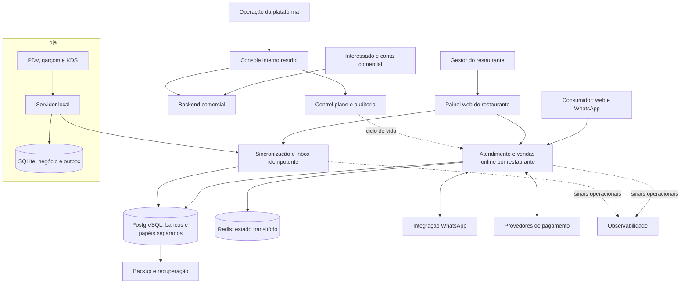
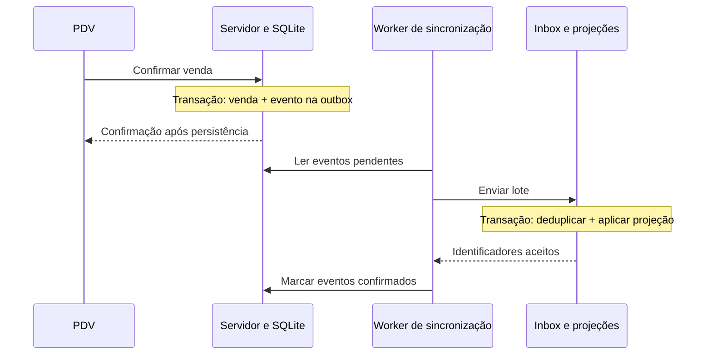

# Arquitetura do MFL

Visão lógica sanitizada, revisada documentalmente em 08/11/2026. As caixas representam responsabilidades; não especificam endereços, rotas, portas ou topologia operacional.

## Isolamento e fronteiras

O núcleo online usa processo, banco e instância de WhatsApp por restaurante. O servidor PostgreSQL e outros recursos de infraestrutura podem ser compartilhados. Essa separação reduz o alcance de erros de aplicação e facilita manutenção por tenant; não elimina falhas comuns de host, banco ou integrações.

O control plane cuida do ciclo de vida dos restaurantes. O backend comercial cuida de leads, contas e acesso. Nenhum deles substitui o backend de negócio do restaurante. Interfaces públicas, painel do restaurante e console interno são aplicações distintas, com código compartilhado onde pertinente.

## Consistência local e nuvem

Se a resposta se perde, o worker pode reenviar. A inbox identifica o evento dentro do tenant e impede repetir o efeito. A entrega é pelo menos uma vez; o efeito depende da deduplicação e da transação no destino. Relatórios remotos podem ficar atrasados enquanto a loja está desconectada. O disco e a saúde do servidor local também impõem limites.

Cada dado tem um sistema responsável: catálogo e pedidos online pertencem ao núcleo online; vendas presenciais, caixa e comandas pertencem ao Gestor. O painel deve encaminhar alterações ao responsável e apresentar falhas parciais quando um formulário alcança mais de um sistema.

## Segurança e operação

Autorização considera o contexto do restaurante e o papel do usuário. Consentimento, transferência para humano e auditoria fazem parte das regras do backend. A configuração específica de cada cliente fica fora do código compartilhado.

Aplicações publicadas como imagem passam por CI, staging e promoção por digest. Os frontends público e do restaurante seguem sua integração de publicação na Vercel. Banco, arquivos e aplicação têm mecanismos de recuperação diferentes; reverter imagem não desfaz uma migração nem recupera dados apagados.

As [decisões](decisoes.md) explicitam custos e alternativas. As [evidências](evidencias.md) delimitam o que pode ser reproduzido aqui.
